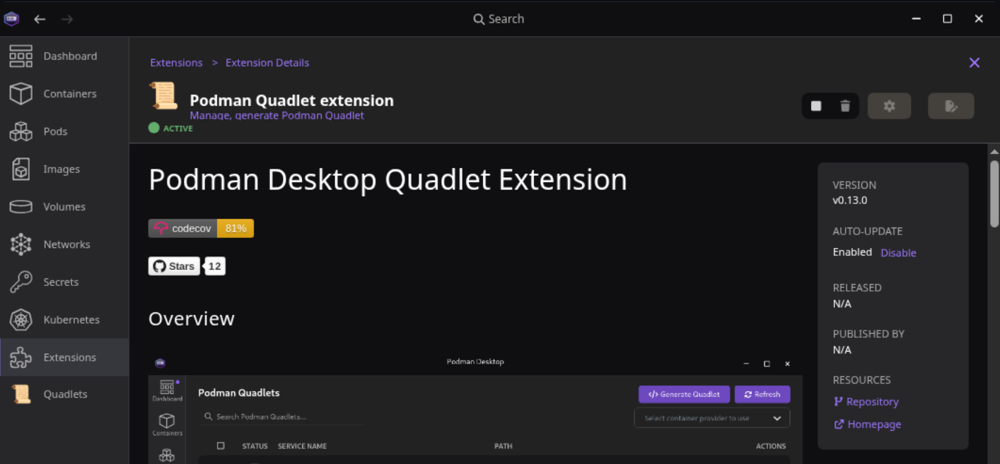
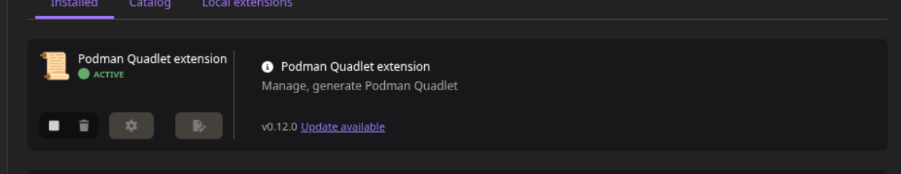

import ThemedImage from '@theme/ThemedImage';
import ReactPlayer from 'react-player';

Podman Desktop 1.31 Release

Podman Desktop 1.31 is now available. [Click here to download it](/downloads)!

The new version of Podman Desktop is here with upgrades that speed up and secure your daily container workflow—featuring
customizable bundled extensions, one-click image updates, a guided Windows Hyper-V setup, and important security
patches:

- **Extension management**: Override bundled extensions with installed replacements, update bundled extensions directly
  from the catalog, and configure auto-updates per extension — complete with "Update available" links and accurate
  lifecycle status indicators.
- **Container image updates:** Update a single image or a bulk selection at once, with live progress tracking and
  cancellation in the task manager.
- **Guided Hyper-V setup on Windows:** Configure Hyper-V for Podman from **Settings > Resources** without running Podman
  Desktop as an administrator.
- **Using existing volumes in Run Image page:** Attach pre-created volumes directly from the Run Image page when
  launching a container.
- **Manage macOS settings with MDM:** Administrators can now distribute default settings and enforce locked configurations
  across managed macOS devices using MDM preference plists.

{/* truncate */}

## Release details

### Extension management

Previously, bundled extensions such as Podman, Docker, Kind, and Compose could not be updated between Podman Desktop
releases—running a patched or newer version required sideloading it without any guarantee it would take precedence. Now,
an installed extension can declare that it _overrides_ a bundled extension, and the loader automatically gives it
priority. You can also update bundled extensions directly from the catalog, with a new **Overrides** badge on the
extension card confirming that your version is the one running.

<ThemedImage
  alt="Extension card displaying the Overrides badge"
  sources={{
    light: require('./img/podman-desktop-release-1.31/overrides-badge-light.png').default,
    dark: require('./img/podman-desktop-release-1.31/overrides-badge-dark.png').default,
  }}
/>

Overriding bundled extensions is paired with granular control over automatic updates. You can now disable auto-updates
for individual extensions from their details page. Whenever a newer version is waiting, an **Update available** link
appears next to the version on both the extension card and the details page so you can apply the update manually.
Lifecycle status indicators have also been refreshed across the UI to align with the updated look and
placement of these controls on both extension cards and details pages

### Container image updates

Updating an image to a newer remote build no longer requires walking through the manual Pull Image flow and re-entering
the tag—you can now check for and pull image updates directly from the UI.

**Single image update:** Trigger an update action directly from the upper-right corner of the Image Details page; Podman
Desktop checks the local digest against the remote manifest and pulls the newer version only if an update exists.
**Bulk images update:** Select multiple images from the Images list and run the update action across the entire batch at
once, automatically skipping any images that are already up to date.
**Non-blocking task tracking:** Image update checks and pulls run in the background as cancellable tasks in the task
manager, ensuring large downloads never lock up the UI.

<ReactPlayer
  playing
  playsInline
  controls
  src="https://github.com/user-attachments/assets/fc9519ed-0c44-4aab-b921-fc3542ff0508"
  width="100%"
  height="100%"
/>

### Guided Hyper-V setup on Windows

On Windows systems with Podman 6.0.0 or later, Podman Desktop now checks `podman system hyperv-prep --status` to verify
whether your account belongs to the Hyper-V Administrators group. When preparation has not yet been applied,
a **Podman: Prepare Hyper-V** action appears on the Podman provider card in **Settings > Resources**. Triggering it
requests a one-time administrator confirmation (UAC) to run `podman system hyperv-prep` in the background, hides
the action once complete, and reminds you to sign out or restart Windows for the changes to take effect. Once
preparation is complete, you no longer need to run Podman Desktop as an administrator to create a Hyper-V VM.

<ThemedImage
  alt="Podman provider card in Settings > Resources showing the Prepare Hyper-V action"
  sources={{
    light: require('./img/podman-desktop-release-1.31/prepare-hyperv-windows-light.png').default,
    dark: require('./img/podman-desktop-release-1.31/prepare-hyperv-windows-dark.png').default,
  }}
/>

### Using existing volumes in Run Image page

Previously, configuring volume mounts on the Run Image page was restricted to host path binds, with no direct way to
select a pre-created named volume without manually typing or remembering its path string. Podman Desktop 1.31 adds a
flexible source-type selector to each mount row, making it easier to attach persistent storage.

**Source-type selection:** Each mount row now includes a dropdown allowing you to switch between **Host path** and
**Existing volume**.

<ThemedImage
  alt="Run Image volume mount row showing the source-type dropdown"
  sources={{
    light: require('./img/podman-desktop-release-1.31/run-image-volume-source-type-light.png').default,
    dark: require('./img/podman-desktop-release-1.31/run-image-volume-source-type-dark.png').default,
  }}
/>

**Engine-filtered volume dropdown:** When **Existing volume** is selected, the host path input swaps for a dropdown
populated from your available volumes, automatically filtered to match the target image's engine and sorted by name. The
dropdown displays reader-friendly short names while submitting the full identifier as the bind source, making it
effortless to select pre-created data volumes without copying and pasting long strings.

<ThemedImage
  alt="Volume selection dropdown filtered by engine and showing volume names"
  sources={{
    light: require('./img/podman-desktop-release-1.31/run-image-volume-dropdown-light.png').default,
    dark: require('./img/podman-desktop-release-1.31/run-image-volume-dropdown-dark.png').default,
  }}
/>

## Manage macOS settings with MDM

Podman Desktop now supports macOS Mobile Device Management (MDM) by reading managed preference files (`.plist`,
in either XML or binary format) at startup and merging them with existing JSON configurations.

Administrators can deploy device-wide defaults and enforce restrictions using a `locked` array at
`/Library/Managed Preferences/io.podman_desktop.PodmanDesktop.plist`, or supply account-specific startup overrides
via per-user plists at `/Library/Managed Preferences/<username>/io.podman_desktop.PodmanDesktop.plist`. By combining
the roles of `default-settings.json` and `locked.json` into standard macOS managed preference files, IT teams can
natively standardize and lock Podman Desktop settings across their macOS fleets.

### Security hardening

This release includes fixes for multiple security vulnerabilities reported through
Dependabot. Updated direct and transitive dependencies address known CVEs and help
keep Podman Desktop's container and extension workflows secure.

### Other improvements

- **Catalog filters**: The extension catalog now understands `is:featured` and `not:featured` in its search, so you can
  narrow results to featured extensions ([#19616](https://github.com/podman-desktop/podman-desktop/pull/19616)).
- **Catalog search placement**: Search moved below the tabs, and the Install Custom dialog now closes as soon as the
  installation starts ([#19889](https://github.com/podman-desktop/podman-desktop/pull/19889),
  [#19621](https://github.com/podman-desktop/podman-desktop/pull/19621)).
- **Settings navigation**: `SettingsNavItem` supports key shortcuts, and preferences search matches both the setting key
  and its display name ([#19204](https://github.com/podman-desktop/podman-desktop/pull/19204)).
- **Registries settings**: The registries page now exposes labeled regions for screen reader users
  ([#19679](https://github.com/podman-desktop/podman-desktop/pull/19679)).
- **Task toast notifications**: Enabled by default, so long-running work reports back when it finishes
  ([#19845](https://github.com/podman-desktop/podman-desktop/pull/19845)).

---

## Community Thank You

🎉 We’d like to say a big thank you to everyone who contributed their first pull request to Podman Desktop in
this release:

- [DeviceDidWhat](https://github.com/DeviceDidWhat) in [docs(website): remove /extend page and redirect
  to /docs/extensions](https://github.com/podman-desktop/podman-desktop/pull/19758)
- [ewerton336](https://github.com/ewerton336) in [fix(container): keep Tty and OpenStdin when creating containers
  through libpod](https://github.com/podman-desktop/podman-desktop/pull/19986)
- [taljeon](https://github.com/taljeon) in [fix(renderer): compact factory property
  descriptions](https://github.com/podman-desktop/podman-desktop/pull/18897)

---

## Community Meeting

If you would like to discuss any of the new features, issues or other topics, please join us at the monthly
community meeting that takes place <b>every 4th Thursday of the month</b>. Here are the

<b>
  meeting
  [details](https://github.com/podman-desktop/community/issues?q=is%3Aissue%20state%3Aopen%20Agenda%20for%20Podman%20Desktop)
</b>
.

---

## Final Notes

The complete list of issues fixed in this release is available
[here](https://github.com/podman-desktop/podman-desktop/issues?q=is%3Aclosed+milestone%3A1.31.0).

Get the latest release from the [Downloads](/downloads) section of the website. Visit the [GitHub
repository](https://github.com/podman-desktop/podman-desktop) to report issues or contribute.

## Detailed Release Changelog

### feat

- feat(main): validate layer download size against the manifest by @axel7083
  [#20028](https://github.com/podman-desktop/podman-desktop/pull/20028)
- feat(main): add dashboard card background color tokens by @vancura
  [#19987](https://github.com/podman-desktop/podman-desktop/pull/19987)
- feat(renderer): move Catalog search below tabs by @JustMello
  [#19889](https://github.com/podman-desktop/podman-desktop/pull/19889)
- feat(main): enable task toast notifications by default by @axel7083
  [#19845](https://github.com/podman-desktop/podman-desktop/pull/19845)
- feat(extensions-updater): update bundled extensions from the catalog by @axel7083
  [#19828](https://github.com/podman-desktop/podman-desktop/pull/19828)
- feat(renderer): update an extension when an update is available by @axel7083
  [#19814](https://github.com/podman-desktop/podman-desktop/pull/19814)
- feat(main): track image updates as tasks by @bmahabirbu
  [#19796](https://github.com/podman-desktop/podman-desktop/pull/19796)
- feat: allowing disabling per extension auto-update by @axel7083
  [#19773](https://github.com/podman-desktop/podman-desktop/pull/19773)
- feat(extension-installer): install an extension replacing a bundled one by @axel7083
  [#19728](https://github.com/podman-desktop/podman-desktop/pull/19728)
- feat(renderer): add labelled regions to the registries settings page by @vancura
  [#19679](https://github.com/podman-desktop/podman-desktop/pull/19679)
- feat(main): select images for updates by engine and image ID by @bmahabirbu
  [#19625](https://github.com/podman-desktop/podman-desktop/pull/19625)
- feat(renderer): close the Install Custom dialog when the installation starts by @axel7083
  [#19621](https://github.com/podman-desktop/podman-desktop/pull/19621)
- feat(renderer): extend catalog extension filters by @JustMello
  [#19616](https://github.com/podman-desktop/podman-desktop/pull/19616)
- feat(renderer): show an Overrides badge on an extension replacing a bundled one by @axel7083
  [#19607](https://github.com/podman-desktop/podman-desktop/pull/19607)
- feat(renderer): add bulk image updates by ID and reduce task info by @bmahabirbu
  [#19550](https://github.com/podman-desktop/podman-desktop/pull/19550)
- feat(renderer): add single image updates by ID by @bmahabirbu
  [#19549](https://github.com/podman-desktop/podman-desktop/pull/19549)
- feat(renderer): use image ID contract for updates by @bmahabirbu
  [#19548](https://github.com/podman-desktop/podman-desktop/pull/19548)
- feat(extension-loader): load an installed extension over the bundled one it overrides by @axel7083
  [#19519](https://github.com/podman-desktop/podman-desktop/pull/19519)
- feat(api): add overrides to extensions by @axel7083
  [#19497](https://github.com/podman-desktop/podman-desktop/pull/19497)
- feat(renderer): update extension lifecycle status indicators by @JustMello
  [#19485](https://github.com/podman-desktop/podman-desktop/pull/19485)
- feat(color-registry): add button-icon, button-detailed and button-spinner colors by @vancura
  [#19417](https://github.com/podman-desktop/podman-desktop/pull/19417)
- feat(ci): add step to generate JSON run attributes for ReportPortal by @tbordak
  [#19396](https://github.com/podman-desktop/podman-desktop/pull/19396)
- feat: added support for F key modifiers to keyboard utils by @gastoner
  [#19395](https://github.com/podman-desktop/podman-desktop/pull/19395)
- feat(RunImage): added option to select and bind pre-created volume to container by @gastoner
  [#19373](https://github.com/podman-desktop/podman-desktop/pull/19373)
- feat(Preferences): added option to register additional button action to provider by @gastoner
  [#19232](https://github.com/podman-desktop/podman-desktop/pull/19232)
- feat(ui): added support for key shortcuts in SettingsNavItem component by @gastoner
  [#19204](https://github.com/podman-desktop/podman-desktop/pull/19204)
- feat(main): allow running packaged and dev instances simultaneously by @fbricon
  [#19043](https://github.com/podman-desktop/podman-desktop/pull/19043)
- feat(ipc): expose image update bridge by @bmahabirbu
  [#18996](https://github.com/podman-desktop/podman-desktop/pull/18996)

### fix

- fix(e2e): revert "gate packaged app startup until Playwright attaches" by @feloy
  [#20090](https://github.com/podman-desktop/podman-desktop/pull/20090)
- fix(e2e): gate packaged app startup until Playwright attaches by @feloy
  [#20065](https://github.com/podman-desktop/podman-desktop/pull/20065)
- fix(main): track dismissed telemetry option when feedback dialog is closed by @kavyabhanvadia
  [#19991](https://github.com/podman-desktop/podman-desktop/pull/19991)
- fix(container): keep Tty and OpenStdin when creating containers through libpod by @ewerton336
  [#19986](https://github.com/podman-desktop/podman-desktop/pull/19986)
- fix(renderer): do not flag dashboard content seen while on the Dashboard by @amisskii
  [#19941](https://github.com/podman-desktop/podman-desktop/pull/19941)
- fix(renderer): yield untagged row when RepoTags is empty by @sundeep8967
  [#19934](https://github.com/podman-desktop/podman-desktop/pull/19934)
- fix: typecheck extension API mocks in CI by @maskjelly
  [#19855](https://github.com/podman-desktop/podman-desktop/pull/19855)
- fix(renderer): query the PullImage error alert by role by @vancura
  [#19813](https://github.com/podman-desktop/podman-desktop/pull/19813)
- fix(renderer): include full date in troubleshooting log timestamps by @kavyabhanvadia
  [#19810](https://github.com/podman-desktop/podman-desktop/pull/19810)
- fix(main): show podman root cause on HTTP 500 error by @tbordak
  [#19788](https://github.com/podman-desktop/podman-desktop/pull/19788)
- fix(main): add high contrast values to content-sub-header color by @vancura
  [#19771](https://github.com/podman-desktop/podman-desktop/pull/19771)
- fix(renderer): align button aria-labels with their visible text by @vancura
  [#19747](https://github.com/podman-desktop/podman-desktop/pull/19747)
- fix(renderer): drop static error label from repair cleanup alert by @vancura
  [#19678](https://github.com/podman-desktop/podman-desktop/pull/19678)
- fix(renderer): expose kube context error message to assistive tech by @vancura
  [#19677](https://github.com/podman-desktop/podman-desktop/pull/19677)
- fix(renderer): drop static aria-label from registry error alerts by @vancura
  [#19676](https://github.com/podman-desktop/podman-desktop/pull/19676)
- fix(ui): hide decorative error icon from assistive tech in Input by @vancura
  [#19675](https://github.com/podman-desktop/podman-desktop/pull/19675)
- fix(main): reset tar ownership in kube play build context by @axel7083
  [#19674](https://github.com/podman-desktop/podman-desktop/pull/19674)
- fix(renderer): let audit record text be the accessible name by @vancura
  [#19673](https://github.com/podman-desktop/podman-desktop/pull/19673)
- fix(ui): remove static aria-label fallback from ErrorMessage by @vancura
  [#19672](https://github.com/podman-desktop/podman-desktop/pull/19672)
- fix: let user run pulled image only after the image is already in images store by @tbordak
  [#19669](https://github.com/podman-desktop/podman-desktop/pull/19669)
- fix(renderer): ensure that cancelId or defaultId at given index 0 are honored by @SoniaSandler
  [#19626](https://github.com/podman-desktop/podman-desktop/pull/19626)
- fix(DropdownMenu): make menu items keyboard-accessible and respect enabled by @vancura
  [#19617](https://github.com/podman-desktop/podman-desktop/pull/19617)
- fix(podman): create containers config directory before writing containers.conf by @vlazar
  [#19575](https://github.com/podman-desktop/podman-desktop/pull/19575)
- fix(onboarding): restart only the most recent onboarding flow when failing a step by @SoniaSandler
  [#19535](https://github.com/podman-desktop/podman-desktop/pull/19535)
- fix(main): use updating label for edit provider connection task by @vancura
  [#19483](https://github.com/podman-desktop/podman-desktop/pull/19483)
- fix(renderer): add a safeguard focus in danger MessageBox when there is no cancelId by @SoniaSandler
  [#19452](https://github.com/podman-desktop/podman-desktop/pull/19452)
- fix(kube): make Play Kubernetes YAML path editable by @vlazar
  [#19391](https://github.com/podman-desktop/podman-desktop/pull/19391)
- fix(storybook): hot-reload ui package changes in storybook:dev by @vancura
  [#19352](https://github.com/podman-desktop/podman-desktop/pull/19352)
- fix: crash when typing an image name with a dot segment by @tbordak
  [#19256](https://github.com/podman-desktop/podman-desktop/pull/19256)
- fix(installer): preserve install scope during Windows update by @JustMello
  [#19128](https://github.com/podman-desktop/podman-desktop/pull/19128)
- fix(windows): preserve disabled startup setting by @joaogabriel15
  [#19104](https://github.com/podman-desktop/podman-desktop/pull/19104)
- fix(renderer): compact factory property descriptions by @taljeon
  [#18897](https://github.com/podman-desktop/podman-desktop/pull/18897)

### chore

- chore(ci): reverting managed-configuration-template ubuntu runner to 24.04 by @ScrewTSW
  [#19909](https://github.com/podman-desktop/podman-desktop/pull/19909)
- chore(website): remove 5M downloads banner by @vancura
  [#19482](https://github.com/podman-desktop/podman-desktop/pull/19482)
- chore(fix): update import and pull buttons icons by @vlazar
  [#19447](https://github.com/podman-desktop/podman-desktop/pull/19447)
- chore: add close/cancel/dismiss buttons to components that use ButtonRow by @SoniaSandler
  [#19441](https://github.com/podman-desktop/podman-desktop/pull/19441)
- chore(ui): fix capitalization of bundled extensions by @cdrage
  [#19347](https://github.com/podman-desktop/podman-desktop/pull/19347)
- chore: use ButtonRow in the rest of the renderer components by @SoniaSandler
  [#19275](https://github.com/podman-desktop/podman-desktop/pull/19275)
- chore: use ButtonRow in image components by @SoniaSandler
  [#19274](https://github.com/podman-desktop/podman-desktop/pull/19274)
- chore: use ButtonRow in containers components, dashboard, dialog, feedback, kube, and network by @SoniaSandler
  [#19272](https://github.com/podman-desktop/podman-desktop/pull/19272)
- chore(docs): fixes GPU macOS documentation by @cdrage
  [#19202](https://github.com/podman-desktop/podman-desktop/pull/19202)
- chore(docs): updated CONTRIBUTING.md to add a section for PR splitting guidelines by @rujutashinde
  [#19201](https://github.com/podman-desktop/podman-desktop/pull/19201)
- chore(flatpak): upgrade runtime and SDK to 26.08 by @benoitf
  [#19094](https://github.com/podman-desktop/podman-desktop/pull/19094)
- chore(website): update website downloads page by @SoniaSandler
  [#19005](https://github.com/podman-desktop/podman-desktop/pull/19005)
- chore(docs): improve custom server updating by @cdrage
  [#18326](https://github.com/podman-desktop/podman-desktop/pull/18326)

### refactor

- refactor(renderer): drop img parameter from fetchImageLayers by @vzhukovs
  [#19902](https://github.com/podman-desktop/podman-desktop/pull/19902)
- refactor(ui): migrate action-button color tokens to button-\* tokens by @vancura
  [#19680](https://github.com/podman-desktop/podman-desktop/pull/19680)
- refactor(main): isolate container registry spec mocks by @bmahabirbu
  [#19658](https://github.com/podman-desktop/podman-desktop/pull/19658)
- refactor(main): replace fs.rmdirSync with fs.rm in extension installer by @h55n
  [#19645](https://github.com/podman-desktop/podman-desktop/pull/19645)
- refactor(renderer): use the Tailwind CSS variable shorthand in ExtensionBadge by @axel7083
  [#19614](https://github.com/podman-desktop/podman-desktop/pull/19614)
- refactor(Table): refactor table selection and sorting by @gastoner
  [#19499](https://github.com/podman-desktop/podman-desktop/pull/19499)
- refactor(renderer): store VolumeInfoUI instead of VolumeListInfo by @vzhukovs
  [#19317](https://github.com/podman-desktop/podman-desktop/pull/19317)
- refactor(ProviderInstalled): added user toggle variable by @gastoner
  [#19209](https://github.com/podman-desktop/podman-desktop/pull/19209)
- refactor(renderer): update container actions to modify store directly by @gastoner
  [#19188](https://github.com/podman-desktop/podman-desktop/pull/19188)
- refactor(Container): migrated ContainerActions to svelte5 by @gastoner
  [#18785](https://github.com/podman-desktop/podman-desktop/pull/18785)
- refactor(Compose): migrated ComposeDetails to svelte5 by @gastoner
  [#18784](https://github.com/podman-desktop/podman-desktop/pull/18784)
- refactor(Dashboard): migrated ProvidersSection to svelte5 by @gastoner
  [#18703](https://github.com/podman-desktop/podman-desktop/pull/18703)
- refactor(Preferences): migrated PreferencesKubernetesConnectionDetailsSummary component to svelte5 by @gastoner
  [#18647](https://github.com/podman-desktop/podman-desktop/pull/18647)

### docs

- docs(website): remove /extend page and redirect to /docs/extensions by @DeviceDidWhat
  [#19758](https://github.com/podman-desktop/podman-desktop/pull/19758)
- docs(ui): document button props and fix misleading button stories by @vancura
  [#19752](https://github.com/podman-desktop/podman-desktop/pull/19752)
- docs(website): document troubleshooting CLI tool install failures caused by dangling symlinks by @roparmar
  [#19721](https://github.com/podman-desktop/podman-desktop/pull/19721)
- docs(website): note that Podman Desktop must be restarted after an external Podman uninstall by @roparmar
  [#19628](https://github.com/podman-desktop/podman-desktop/pull/19628)
- docs(guidelines): resolve Cancel vs Close conflict in two-choice dialogs by @vancura
  [#19612](https://github.com/podman-desktop/podman-desktop/pull/19612)
- docs(website): add guidance on aliasing the Docker CLI to Podman by @roparmar
  [#19582](https://github.com/podman-desktop/podman-desktop/pull/19582)
- docs(website): added explicit css styles by @gastoner
  [#19541](https://github.com/podman-desktop/podman-desktop/pull/19541)
- docs(guidelines): update CODE-GUIDELINES.md with ButtonRow info by @SoniaSandler
  [#19458](https://github.com/podman-desktop/podman-desktop/pull/19458)
- docs(blog): add Kubernetes Extension Pack release blog post by @feloy
  [#19366](https://github.com/podman-desktop/podman-desktop/pull/19366)
- docs: add contribution expectations for AI-assisted PRs by @JustMello
  [#19116](https://github.com/podman-desktop/podman-desktop/pull/19116)
- docs(website): migrated to docusaurus v4 by @gastoner
  [#18282](https://github.com/podman-desktop/podman-desktop/pull/18282)

### test

- fix(test): skip feedback suite before launching Electron by @feloy
  [#19983](https://github.com/podman-desktop/podman-desktop/pull/19983)
- test(e2e): add e2e tests for cancel and create buttons on run image page by @kavyabhanvadia
  [#19931](https://github.com/podman-desktop/podman-desktop/pull/19931)
- chore(test): refactor some flaky behavior by @vlazar
  [#19915](https://github.com/podman-desktop/podman-desktop/pull/19915)
- chore(test): increasing podman machine shutdown wait timer by @vlazar
  [#19900](https://github.com/podman-desktop/podman-desktop/pull/19900)
- chore(test): update element locator by @vlazar [#19890](https://github.com/podman-desktop/podman-desktop/pull/19890)
- chore(test): add installation assets spec by @odockal
  [#19886](https://github.com/podman-desktop/podman-desktop/pull/19886)
- chore(test): ensure podman machine status update by force refresh by @vlazar
  [#19882](https://github.com/podman-desktop/podman-desktop/pull/19882)
- chore(test): improve e2e test robustness by @vlazar
  [#19875](https://github.com/podman-desktop/podman-desktop/pull/19875)
- chore(test): making electron runner launch timeout configurable by @vlazar
  [#19811](https://github.com/podman-desktop/podman-desktop/pull/19811)
- test(e2e): add environment filter E2E test for the Volumes page by @kavyabhanvadia
  [#19799](https://github.com/podman-desktop/podman-desktop/pull/19799)
- test(e2e): skip pod environment filter tests on Hyper-V by @davillan
  [#19789](https://github.com/podman-desktop/podman-desktop/pull/19789)
- chore(test): fixing some broken tests by @vlazar [#19763](https://github.com/podman-desktop/podman-desktop/pull/19763)
- chore(test): update action version by @vlazar [#19748](https://github.com/podman-desktop/podman-desktop/pull/19748)
- chore(test): remove cpu and memory limit from container by @vlazar
  [#19722](https://github.com/podman-desktop/podman-desktop/pull/19722)
- test(main): guard button focus ring contrast against surfaces by @vancura
  [#19660](https://github.com/podman-desktop/podman-desktop/pull/19660)
- chore(test): add specs for verification of the data/config folders structure by @odockal
  [#19639](https://github.com/podman-desktop/podman-desktop/pull/19639)
- chore(test): add custom built-in extensions e2e resources by @odockal
  [#19622](https://github.com/podman-desktop/podman-desktop/pull/19622)
- chore(test): add test case for builtin extensions smoke spec by @odockal
  [#19615](https://github.com/podman-desktop/podman-desktop/pull/19615)
- chore(test): add timeouts to test workflows by @vlazar
  [#19557](https://github.com/podman-desktop/podman-desktop/pull/19557)
- chore(test): enabled parametrized catalog extension name filtering by @vlazar
  [#19539](https://github.com/podman-desktop/podman-desktop/pull/19539)
- chore(test): add help menu e2e tests agnostic of downstream by @vlazar
  [#19517](https://github.com/podman-desktop/podman-desktop/pull/19517)
- refactor(tests): no spy on mocked modules by @axel7083
  [#19501](https://github.com/podman-desktop/podman-desktop/pull/19501)
- test(e2e): update serial declaration - part 17 by @davillan
  [#19439](https://github.com/podman-desktop/podman-desktop/pull/19439)
- test(e2e): update serial declaration - part 16 by @davillan
  [#19438](https://github.com/podman-desktop/podman-desktop/pull/19438)
- test(e2e): update serial declaration - part 15 by @davillan
  [#19399](https://github.com/podman-desktop/podman-desktop/pull/19399)
- test(e2e): update serial declaration - part 14 by @davillan
  [#19394](https://github.com/podman-desktop/podman-desktop/pull/19394)
- test(e2e): update serial declaration - part 13 by @davillan
  [#19393](https://github.com/podman-desktop/podman-desktop/pull/19393)
- test(e2e): update serial declaration - part 12 by @davillan
  [#19378](https://github.com/podman-desktop/podman-desktop/pull/19378)
- chore(test): skip some tests when running with CDP by @vlazar
  [#19361](https://github.com/podman-desktop/podman-desktop/pull/19361)
- chore(test): increase some timeouts to help with system lag by @vlazar
  [#19343](https://github.com/podman-desktop/podman-desktop/pull/19343)
- test(e2e): filter pods by environment by @davillan
  [#19076](https://github.com/podman-desktop/podman-desktop/pull/19076)

### ci

- ci(e2e): add label-triggered full E2E workflow for Windows on PR by @davillan
  [#19646](https://github.com/podman-desktop/podman-desktop/pull/19646)
