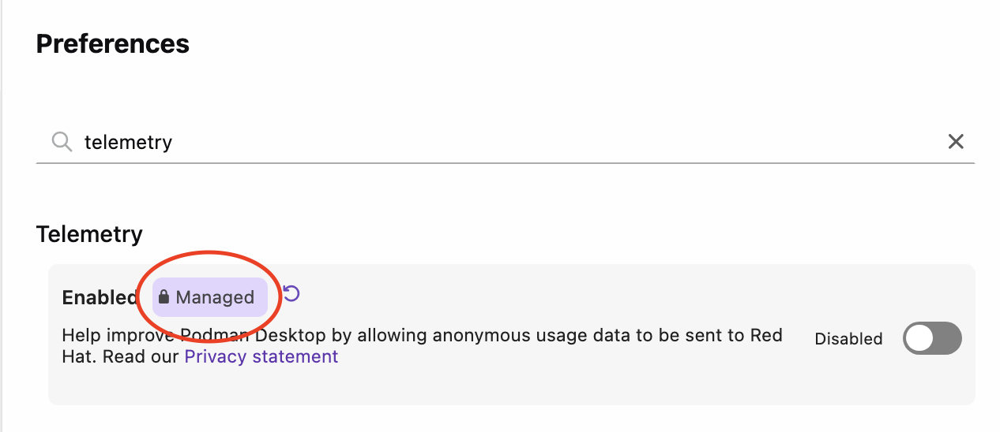

# Troubleshooting managed configuration

When implementing managed configuration in an enterprise environment, you may encounter some common issues often caused by file location, permissions, or syntax errors.

## Locked configuration not working

If your locked configuration is not being applied, try the following solutions:

1. Verify file locations are correct for your operating system.
2. Check file permissions (files must be owned by root/administrator).
3. Ensure JSON syntax is valid (use a JSON validator).
4. Restart Podman Desktop after creating configuration files.

## Settings not being enforced

If settings appear to be locked but values are not being enforced correctly:

1. Check that the key name in `locked.json` exactly matches the key in `default-settings.json`.
2. Verify the configuration key uses dot notation (e.g., `proxy.http`, not `proxy: { http: ... }`).
3. Check console output for error messages.

## Verifying configuration is loaded

To verify that your managed configuration is being loaded correctly:

1. Open Podman Desktop.
2. Go to **Help > Troubleshooting**, and select the **Logs** tab to check for messages such as:
3. Look for messages in the console like:
   ```
   [Managed-by]: Loaded managed ...
   [Managed-by]: Applied default settings for: setting.key1, setting.key2
   ```
4. If you don't see these messages, the configuration files may not be in the correct location or may have syntax errors.

:::note

The "Applied default settings" message only appears when settings are copied from `default-settings.json` to the user's `settings.json`. This occurs once per setting when it doesn't already exist in the user's configuration.

:::

## Verifying if a value is locked by the managed-by configuration

To verify in the GUI if a value is locked by your managed-by configuration:

1. Open Podman Desktop.
2. Go to **Settings > Preferences**.
3. Find your managed-by value:



4. Confirm that it has the **Managed** label applied.

## File permission issues

On Linux and macOS, managed configuration files must have appropriate permissions:

- Files must be owned by root/administrator
- Files should be readable by all users but writable only by root/administrator
- Use `chmod 644` for the configuration files on Linux/macOS

## macOS MDM preferences

### A profile is installed, but the settings do not appear

1. Make sure that the preference domain is `io.podman_desktop.PodmanDesktop`.
2. Make sure that the file exists at the [device or per-user path](/docs/configuration/managed-configuration-macos#preference-domain-and-locations).
3. For a per-user file, make sure that the directory name matches the account's short name.
4. Run this command as the affected user:

   ```shell
   /usr/bin/plutil -convert json -o - "/Library/Managed Preferences/io.podman_desktop.PodmanDesktop.plist"
   ```

   For a per-user policy, use that user's plist path instead.

5. Make sure that the command succeeds without `sudo`.
6. Make sure that the output contains top-level dotted keys, such as `telemetry.enabled`.
7. Make sure that the file contains the application settings dictionary without a configuration profile wrapper.
8. Restart Podman Desktop.
9. Open **Help > Troubleshooting > Logs**.
10. Find the messages that start with `[Managed-by]:`.

### Log messages

| Message                                                     | Meaning                                                                                                             |
| ----------------------------------------------------------- | ------------------------------------------------------------------------------------------------------------------- |
| `Loaded managed preferences from:`                          | The reader accepted the plist at the displayed path. This does not establish that every setting is valid or locked. |
| `Failed to read managed preferences from`                   | The reader ignored the file. The accompanying error identifies the read, conversion, or format failure.             |
| `Managed preferences must contain a dictionary`             | The plist does not contain a settings dictionary at its root.                                                       |
| `Managed preference locks must contain an array of strings` | The `locked` value is invalid. The reader ignores the entire file, including its other settings.                    |

The `Applied default settings for:` message lists defaults that fill missing user values.
It does not report per-user overrides or every enforced value.
Podman Desktop can load a valid policy without this message.
A missing plist does not produce a log message.

### A value loads, but does not stay locked

1. Put the key in the device plist's `locked` array or in `locked.json`.
2. Supply its managed value in the device plist or `default-settings.json`.
3. Make sure that the key names match exactly, including capitalization and dots.
4. Make sure that the value type matches the [settings reference](/docs/configuration/settings-reference).
5. Restart Podman Desktop.

A per-user plist cannot add locks. Unlocked device defaults do not replace existing user values.
A lock without a managed value does not enforce a value, even if the UI displays a lock.

### A changed or removed policy leaves the old value

1. Restart Podman Desktop after the policy change.
2. Compare the active sources with the [configuration precedence rules](/docs/configuration/managed-configuration-macos#configuration-precedence).
3. To remove a lock, remove the key from the device plist's `locked` array and `locked.json`, where applicable.
4. After policy removal, update any unwanted value that remains in the user's preferences.

Policy removal does not erase saved user values. An empty device lock list does not clear JSON locks.

## Additional resources

- [Manage macOS settings with MDM](/docs/configuration/managed-configuration-macos)
- [Configuring a managed user environment](/docs/configuration/managed-configuration)
- [Managed configuration use cases](/docs/configuration/managed-configuration-use-cases)
- [Configuration settings reference](/docs/configuration/settings-reference)
